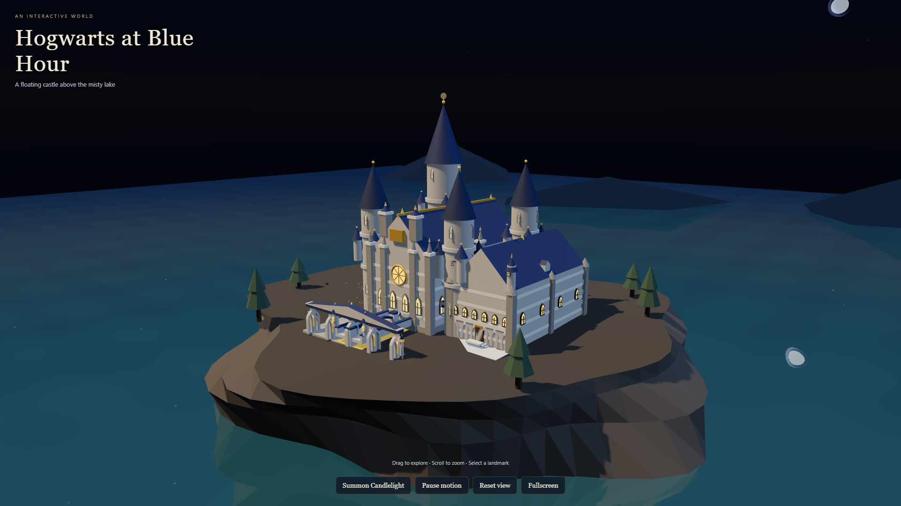
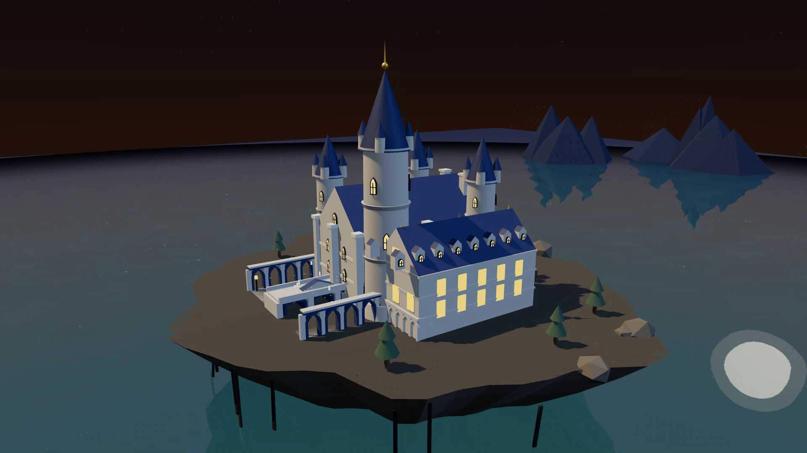

<h1 align="center">TensorFold RTX 5090 Experiments</h1>

<p align="center"><strong>Qwen3.8-27B NVFP4 · Eight concurrent branches · One 32 GB GPU</strong></p>
<p align="center">Two local agent experiments, with the source, recordings and instructions to try them yourself.</p>

<p align="center">
  <a href="#install"></a>
  <a href="#watch-the-recordings"></a>
  <a href="docs/measurements.md"></a>
</p>
<p align="center">
  <a href="CREDITS.md"></a>
  <a href="LICENSE"></a>
  <a href="https://github.com/Maharajahu/tensorfold-rtx5090-experiments/releases/tag/demos-2026-11"></a>
</p>

<p align="center">
  <a href="https://x.com/ToolBraidComp"></a>
  <a href="https://buymeacoffee.com/dumitrescup"></a>
</p>

<p align="center">Built on <a href="https://github.com/ashhart/TensorFold"><strong>TensorFold</strong></a> by <a href="https://github.com/ashhart">Ash (@ashhart)</a> and its contributors, with <a href="https://github.com/can1357/oh-my-pi">Oh My Pi</a>.</p>

Two experimental Windows setups for running Qwen3.8-27B NVFP4 on a single RTX 5090 32 GB, using [TensorFold](https://github.com/ashhart/TensorFold), a 4-bit DFlash2 drafter, and [Oh My Pi](https://github.com/can1357/oh-my-pi) (OMP).

The repository preserves the configurations used in two recorded tests. It includes native source patches, agent extensions, pinned model references, setup scripts, and test workloads. The native patches apply independently to the same pinned TensorFold revision.

## Watch the recordings

Real agent sessions and the generated scenes. Select a button to download the original 1080p MP4.

<table>
  <tr>
    <th width="50%">01 · Fanout</th>
    <th width="50%">02 · Shared context</th>
  </tr>
  <tr>
    <td width="50%" valign="top" align="center">
      <a href="https://github.com/Maharajahu/tensorfold-rtx5090-experiments/releases/download/demos-2026-11/fanout-scene-1080p.mp4"></a>
      <p><strong>660.75 tokens/s aggregate</strong><br>Thinking off · 8 branches<br><sub>11 November 2026</sub></p>
      <a href="https://github.com/Maharajahu/tensorfold-rtx5090-experiments/releases/download/demos-2026-11/fanout-live-660tps-1080p.mp4"></a>
      <br>
      <a href="https://github.com/Maharajahu/tensorfold-rtx5090-experiments/releases/download/demos-2026-11/fanout-scene-1080p.mp4"></a>
    </td>
    <td width="50%" valign="top" align="center">
      <a href="https://github.com/Maharajahu/tensorfold-rtx5090-experiments/releases/download/demos-2026-11/shared-context-scene-low-1080p.mp4"></a>
      <p><strong>498.99 tokens/s aggregate</strong><br>Thinking low · 8 branches<br><sub>12 November 2026</sub></p>
      <a href="https://github.com/Maharajahu/tensorfold-rtx5090-experiments/releases/download/demos-2026-11/shared-context-live-low-499tps-1080p.mp4"></a>
      <br>
      <a href="https://github.com/Maharajahu/tensorfold-rtx5090-experiments/releases/download/demos-2026-11/shared-context-scene-low-1080p.mp4"></a>
    </td>
  </tr>
</table>

Live clips retain the captured timing; scene walkthroughs are separate recordings of the generated outputs. Video duration differs from the measured generation interval. [Video provenance and checksums](docs/videos.md).

## The two versions

| | `fanout` — 11 November 2026 | `shared-context` — 12 November 2026 |
|---|---|---|
| Workload | Specialized Three.js scene agent | Coding agent with eight synchronized proposal branches |
| Thinking | Off | Low, with a 2,048-token thinking budget |
| Context setting | 4,096 | 65,536 |
| Parallel branches in the recording | 8 | 8 |
| Completed branch tokens | 13,336 | 27,974, including 16,044 reasoning tokens |
| Parallel generation interval | 20.183 s | 56.061 s |
| **Aggregate throughput** | **660.754 tokens/s** | **498.991 tokens/s** |
| Highest sampled one-second rate | 946.845 tokens/s | 716.289 tokens/s |
| Complete agent turn | 33.542 s | 101.389 s |

These are measured examples, not guaranteed speeds. Aggregate throughput combines concurrent branches; it is not the speed of one response. Peaks are short telemetry windows and are not sustained averages. The two workloads, thinking settings, and timing boundaries differ, so this table is not a controlled performance comparison. See [measurement details](docs/measurements.md) and the [recorded data](results/recorded-runs.json).

`fanout` plans and builds a stylized castle scene with eight components. It uses a reduced draft-output projection for a seven-node draft tree. `shared-context` reuses common prompt state in GPU memory and starts a group of branches together. Its coordinator integrates the proposals and runs checks. It can also work on other coding tasks; the published performance result is only for the supplied scene workload.

## Requirements

The tested target is **Windows x64 with an NVIDIA RTX 5090, 32 GB VRAM**. Other GPUs and operating systems have not been qualified for these patches. Use one variant at a time so their models do not compete for VRAM.

- Git, Python 3.11 or later (tested with 3.12.10), and Node.js 24 with npm (tested with 24.15.0).
- Zig **0.17.0** and CUDA Toolkit **13.3**, including `nvcc`.
- Visual Studio 2022 C++ Build Tools and a Windows SDK. The original build used MSVC 14.44.35207 and Windows SDK 10.0.26100.0.
- A compatible NVIDIA driver and enough disk space for both checkpoints, two source/build directories, and build caches. Model downloads are large; the manifest lists exact file sizes.

TensorFold is pinned to `6e9af930261a88bb28ac0bfb157ce8e57e9eea07`. OMP is pinned to **18.18.8**. Models are pinned to exact revisions of `nvidia/Qwen3.8-27B-NVFP4` and `z-lab/Qwen3.8-27B-DFlash2`. Setup verifies file hashes and downloads no model code for execution.

## Install

Run these commands in PowerShell. A path containing spaces is supported.

```powershell
git clone https://github.com/Maharajahu/tensorfold-rtx5090-experiments.git
cd tensorfold-rtx5090-experiments
python -m venv .venv
& .\.venv\Scripts\python.exe -m pip install -r requirements.txt
& .\.venv\Scripts\python.exe scripts/setup.py all --variant all
```

For an explicit compiler location, add `--zig 'C:\tools\zig\zig.exe' --cuda-path 'C:\Program Files\NVIDIA GPU Computing Toolkit\CUDA\v13.3'` to the setup command. With a portable CUDA installation, also set `$env:CUDA_PATH = 'C:\tools\cuda-13.3'` to its actual directory in the terminal used to launch the agent, so its runtime can find the CUDA DLLs. The build targets SM120 and writes a separate executable for each variant under `.runtime/`.

If the checkpoints are already present, verify and reuse them instead of downloading them again:

```powershell
& .\.venv\Scripts\python.exe scripts/setup.py models --model-path 'C:\models\Qwen3.8-27B-NVFP4' --drafter-path 'C:\models\Qwen3.8-27B-DFlash2'
& .\.venv\Scripts\python.exe scripts/setup.py prepare --variant all
& .\.venv\Scripts\python.exe scripts/setup.py build --variant all
& .\.venv\Scripts\python.exe scripts/setup.py omp
```

`python scripts/setup.py --help` describes the stages. `--omp-path` can reuse an existing copy of the exact pinned OMP executable after hash verification.

Install the scene dependencies once for either scene example:

```powershell
npm ci --prefix variants/fanout/lint
& .\.venv\Scripts\python.exe variants/fanout/prepare_assets.py
& .\.venv\Scripts\python.exe -m playwright install chromium
```

## Test the fanout version

```powershell
.\variants\fanout\Start-Agent.cmd
```

Enter the recorded prompt:

> build me a html three.js website for harry potter, it should be a masterpiece.

The terminal shows the concurrent component streams and measured throughput. The scene is written inside the selected workspace. The historical result is a stylized scene; the wording of the prompt is not a claim of photorealistic or masterpiece quality.

To use another empty workspace:

```powershell
.\variants\fanout\Start-Agent.cmd -WorkingDirectory 'C:\work\fanout-test'
```

## Test the shared-context version

```powershell
.\variants\shared-context\Start-Agent.cmd -WorkingDirectory 'C:\work\shared-agent-test'
```

For your own coding task, ask the agent to implement it, use independent branches where useful, integrate the results, and run tests. Add `-Continue` to resume the latest conversation in that workspace.

The recorded scene example and its launch instructions are in [the shared-context workload](variants/shared-context/demo/README.md). Its prepared inputs define eight components; the model must generate and integrate their implementation. The recorded launcher prompt was:

> Build the scene in TASK.md with eight synchronized branches. Integrate the files and verify the result in the browser. Use English throughout; finish with a two-line summary.

Both launchers stop a runtime they started when OMP exits. Each runtime binds to localhost only. The agent's file and terminal tools operate with your user account's permissions; use a disposable project when experimenting. Generated source and conversation receipts are saved locally and excluded from Git.

## Inspect and stop a runtime

```powershell
& .\.venv\Scripts\python.exe variants/fanout/runtime_control.py status
& .\.venv\Scripts\python.exe variants/fanout/runtime_control.py stop
& .\.venv\Scripts\python.exe variants/shared-context/runtime_control.py status
& .\.venv\Scripts\python.exe variants/shared-context/runtime_control.py stop
```

The helpers only stop their own recorded process, after checking its identity. The two inference ports are 18190 and 18192. If a port belongs to another service, setup refuses to replace it.

## Validation and reporting results

See [validation](docs/validation.md) for checks performed on this package and commands to run locally. For a useful comparison, report your GPU and VRAM, operating system, driver, compiler versions, native patch, model revisions, context, thinking setting, active branches, completed tokens, timing boundary, and any failures. Include failed runs rather than keeping only the fastest sample.

## Credits and origin

The starting point is **[TensorFold](https://github.com/ashhart/TensorFold), created by [Ash (@ashhart)](https://github.com/ashhart) and its contributors**. Ash's fanout demonstrations inspired the first experiment. This repository builds on the native TensorFold engine and adds the experimental Windows patches, OMP integrations, workloads and reproduction scripts shown here.

| Project / authors | Contribution to these experiments |
|---|---|
| [TensorFold · Ash and contributors](https://github.com/ashhart/TensorFold) | Native inference engine; both patches start at [commit `6e9af93`](https://github.com/ashhart/TensorFold/commit/6e9af930261a88bb28ac0bfb157ce8e57e9eea07). |
| [Oh My Pi · @can1357, Stencil Labs and contributors](https://github.com/can1357/oh-my-pi) | Coding-agent terminal, conversation and extension runtime; pinned to 18.18.8. |
| [Qwen team / Alibaba](https://huggingface.co/Qwen/Qwen3.8-27B) · [NVIDIA](https://huggingface.co/nvidia/Qwen3.8-27B-NVFP4) | Qwen3.8-27B base model and the NVFP4 checkpoint used here. |
| [Inco AI](https://inco.ai/blog/dflash2/) · [Z Lab](https://github.com/z-lab/dflash) | DFlash 2 speculative drafter and original DFlash research; the pinned checkpoint is from the [Z Lab mirror](https://huggingface.co/z-lab/Qwen3.8-27B-DFlash2). |
| [Three.js contributors](https://github.com/mrdoob/three.js/tree/r180) | 3D rendering library for the demonstration scenes. |
| [Maharajahu](https://github.com/Maharajahu) | Local experiment patches, agent harnesses, RTX 5090 measurements, recordings and portable setup in this repository. |

[Full credits, pinned sources and research references](CREDITS.md). The local OMP integration is independently implemented; the upstream engine and its authors retain their attribution.

## License

Local code and changes are provided under [Apache-2.0](LICENSE). Upstream copyright and third-party notices are retained in [licenses/TensorFold](licenses/TensorFold). External models, OMP, Three.js, and other dependencies retain their respective licenses. No model weights or prebuilt executables are committed.

## Feedback and support

[Report an issue](https://github.com/Maharajahu/tensorfold-rtx5090-experiments/issues/new) with the variant, hardware, setup command and relevant error. For performance reports, include the settings and timing boundary described in [measurement details](docs/measurements.md).

Maintained by [Maharajahu](https://github.com/Maharajahu). Follow [@ToolBraidComp](https://x.com/ToolBraidComp) for updates or [buy me a coffee](https://buymeacoffee.com/dumitrescup) to support the work. Donations are optional; the source and instructions are available to everyone.
