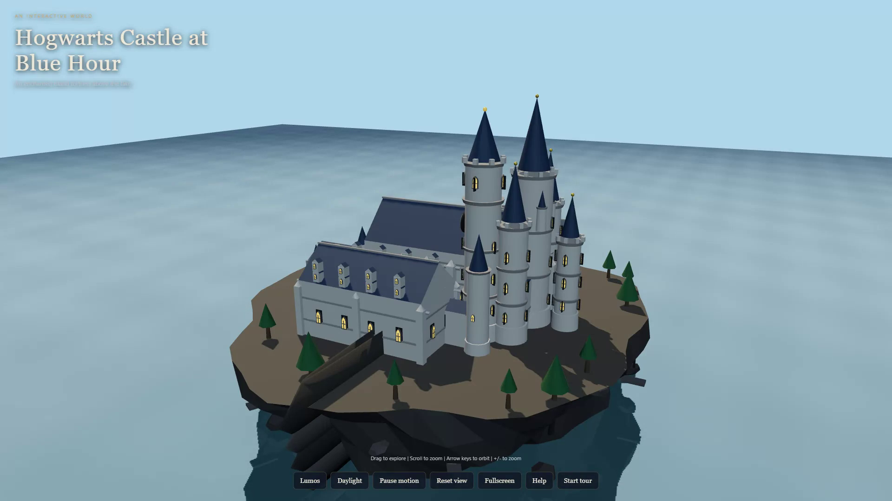

<h1 align="center">BLACKFURY Exact</h1>
<p align="center"><strong>Qwen3.8-27B NVFP4 + DFlash2 on one RTX 5090 32 GB</strong><br>Single-stream inference · 131,072-token context · All active inference state in GPU VRAM</p>
<p align="center"><strong>V 1.0.1 · 17 November 2026</strong><br><strong>309.53 tok/s</strong> warm decode median at 129,024 input + 2,048 output tokens</p>

<p align="center">
  <a href="#install"></a>
  <a href="#watch"></a>
  <a href="#verify"></a>
  <a href="docs/blackfury-stage44.md"></a>
</p>
<p align="center">Powered by <a href="https://github.com/ashhart/TensorFold"><strong>TensorFold</strong></a>, created by <a href="https://github.com/ashhart">Ash (@ashhart)</a> and its contributors.</p>

A native, OpenAI-compatible inference server for Windows and RTX 5090. This repository includes the source patches, pinned model revisions, build scripts, recorded workloads and verification receipts. Connect your own client; the filmed coding demonstrations use [Oh My Pi](https://github.com/can1357/oh-my-pi).

**What's new:** V 1.0.1 pairs the FP4 gate and up projections in one CUDA launch, preserving each projection's existing arithmetic. Its package directory and technical build identifier are `blackfury-stage44`.

**Qualification:** V 1.0.1 inherits approximate FP8 attention and an unresolved inherited-prefill race diagnostic. Its recorded output matches the Stage41 control on the published fixture; this does not establish universal equivalence to upstream. [Qualification details](docs/blackfury-stage44.md#source-build-and-limitations). The [previous BLACKFURY Exact build](#previous-versions) retains its separate byte-match evidence.

## Watch

[](https://drive.google.com/file/d/14rijQHUTPrr-30HSkUxw2ipJ6JEmQHhP/view)

<p align="center">
  <a href="https://drive.google.com/file/d/14rijQHUTPrr-30HSkUxw2ipJ6JEmQHhP/view"><strong>Watch the live agent · 6 min 03 s</strong></a>
  &nbsp;·&nbsp;
  <a href="https://drive.google.com/file/d/1Ca1HmDVqGv9h1Tk7Rmc8OtqmxgJlKtbQ/view"><strong>Watch the resulting scene · 20 s</strong></a>
</p>

Both recordings are **1080p / 60 fps, normal speed**. The live recording shows the technical build name, Stage44; the sampled peak appears near **05:21.5**. The task produced a stylized Three.js castle, followed by five browser checks and four rounds of visual repairs. A separate visual supervisor inspected screenshots and returned feedback to the local agent. [Demonstration details and telemetry definitions](docs/blackfury-stage44.md#real-coding-demonstration).

## Measured performance

### Controlled full-context benchmark

**129,024 input + 2,048 output = 131,072 tokens.** One stream, thinking LOW, greedy decoding, seed 42. Windows / RTX 5090 32 GB, measured on 17 November 2026.

| Measurement | Stage41 control | V 1.0.1 | Change |
|---|---:|---:|---:|
| Warm decode median, DFlash2 enabled | 306.80 tok/s | **309.53 tok/s** | **+0.891%** |
| Warm decode median, no drafter | 54.61 tok/s | **55.61 tok/s** | **+1.835%** |
| Cold prefill, DFlash2 enabled | 50.27 s | 50.37 s | No measured improvement |

The comparison contains **32 requests**, with six warm samples per arm and mode, using interleaved fresh processes. Warm first-token latency remained approximately **0.236 s**. Decode speed excludes prefill and model loading. All 32 requests produced the same 2,048 output token IDs. [Full conditions, results and recorded configuration](docs/blackfury-stage44.md#controlled-full-context-result).

### Separate real coding task

| Measurement across the filmed task | V 1.0.1 |
|---|---:|
| Weighted decode rate over 36 requests | **376.54 tok/s** |
| Highest approximately one-second decode sample | **753.29 tok/s peak** |
| Whole-task output rate, including tools and review pauses | **100.08 tok/s** |

This fresh coding session generated **35,755 tokens**, including reasoning, with a largest actual input of **58,589 tokens**. It used thinking LOW and a 1,024-token reasoning budget. Whole-file repairs repeat existing source and affect speculative acceptance. The short peak and coding-task average have different context and cache conditions from the controlled full-context benchmark. [Request counts and timing definitions](docs/blackfury-stage44.md#real-coding-demonstration).

## Install

The qualified target is **Windows x64 + NVIDIA RTX 5090, 32 GB VRAM**. Other GPUs and operating systems have not been qualified for these patches. Run one engine variant at a time.

<a id="requirements"></a>

Requirements:

- Git and Python **3.11+**; tested with Python 3.12.10.
- Zig **0.17.0** and CUDA Toolkit **13.3**, including `nvcc`; V 1.0.1 targets **SM120a**.
- Visual Studio 2022 C++ Build Tools and a Windows SDK.
- Installed **NVTX3 headers**, for example from NVIDIA Nsight Systems. The include directory must contain `nvtx3/nvToolsExt.h`.
- A compatible NVIDIA driver and disk space for both pinned checkpoints, source and build caches. [Exact model revisions and file sizes](engine-manifest.json).

Build and launch **V 1.0.1** in PowerShell. Replace the three tool paths below with your installed locations:

```powershell
git clone https://github.com/Maharajahu/qwen3.8-27b-nvfp4-blackfury-exact-tensorfold.git
cd qwen3.8-27b-nvfp4-blackfury-exact-tensorfold
python -m venv .venv
& .\.venv\Scripts\python.exe -m pip install -r requirements.txt
& .\.venv\Scripts\python.exe scripts/setup.py models
& .\.venv\Scripts\python.exe scripts/setup.py prepare --variant blackfury-stage44
$env:CUDA_PATH = 'C:\tools\cuda-13.3'
& .\.venv\Scripts\python.exe scripts/setup.py build --variant blackfury-stage44 --zig 'C:\tools\zig\zig.exe' --cuda-path $env:CUDA_PATH --nvtx-include 'C:\tools\Nsight Systems\target-windows-x64\nvtx\include'
& .\.venv\Scripts\python.exe variants/blackfury-stage44/runtime_control.py start
```

The model step downloads and hash-checks the pinned `nvidia/Qwen3.8-27B-NVFP4` and `z-lab/Qwen3.8-27B-DFlash2` checkpoints. To reuse existing copies, replace that step with:

```powershell
& .\.venv\Scripts\python.exe scripts/setup.py models --model-path 'C:\models\Qwen3.8-27B-NVFP4' --drafter-path 'C:\models\Qwen3.8-27B-DFlash2'
```

| Server setting | Default |
|---|---|
| OpenAI-compatible base URL | `http://127.0.0.1:18230/v1` |
| Model ID | `blackfury-exact-v1.0.1` |
| Context / concurrency | 131,072 tokens / one stream |
| Generation | Thinking LOW, 1,024-token reasoning budget, greedy, DFlash2 enabled |

Connect your client after `start` reports a healthy server. The native server runs independently of OMP; Node.js and a browser are needed only for the optional coding-agent and scene examples.

```powershell
& .\.venv\Scripts\python.exe variants/blackfury-stage44/runtime_control.py status
& .\.venv\Scripts\python.exe variants/blackfury-stage44/runtime_control.py stop
```

The launcher binds to localhost and checks process identity before stopping its server. The controlled benchmark used a **2,048-token reasoning budget** and different cache options from the demonstration defaults. [Detailed build, launch and reproduction instructions](variants/blackfury-stage44/README.md).

## Verify

Check the published full-context evidence with **Python's standard library only**. No GPU, running server or model download is required:

```powershell
python scripts/verify_stage44_receipts.py
```

The verifier checks file hashes, binds receipts to the original SSE responses, compares all 2,048 output token IDs across **32 requests**, and recomputes the four warm decode medians. [Evidence packet and exact request](results/blackfury-stage44/README.md).

Publication checks also covered clean patch reconstruction, 188 source hashes, a native build, 219 CPU host tests and five setup tests. The rebuilt executable was not run on the GPU; the performance numbers come from the recorded binary. [Publication receipt](results/blackfury-stage44/publication-checks.json) · [Kernel qualification and limits](docs/blackfury-stage44.md#paired-projection-qualification).

## Previous versions

The earlier engines remain available with their original source, measurements and recordings.

| Variant | Recorded result | Documentation |
|---|---|---|
| Previous `blackfury-exact` | **280.88 tok/s** warm decode median at 129,024 input + 2,048 output; byte-matched to its preserved original in verified tests | [Build and run](variants/blackfury-exact/README.md) · [Results](docs/blackfury-exact.md) · [Byte-match evidence](results/blackfury-exact/reproduction/README.md) |
| `experimental12` | **791 tok/s aggregate** across twelve filmed thinking-LOW branches | [Build and run](variants/experimental12/README.md) · [Results](docs/experimental12.md) |
| `shared-context` | **498.99 tok/s aggregate** across eight thinking-LOW branches | [Agent example](variants/shared-context/demo/README.md) · [Measurements](docs/measurements.md) |
| `fanout` | **660.75 tok/s aggregate** across eight thinking-OFF branches | [Agent example](#earlier-agent-examples) · [Measurements](docs/measurements.md) |

These workloads and timing boundaries differ. Concurrent-branch totals describe aggregate throughput; each variant's measurements apply to its own recorded configuration.

<details>
<summary>Earlier single-stream recording and parallel agent examples</summary>

### Previous BLACKFURY Exact recording

[](https://github.com/Maharajahu/qwen3.8-27b-nvfp4-blackfury-exact-tensorfold/releases/download/demos-2026-11/blackfury-exact-scene-daylight-1080p.mp4)

[Live agent · 8 min 18 s](https://github.com/Maharajahu/qwen3.8-27b-nvfp4-blackfury-exact-tensorfold/releases/download/demos-2026-11/blackfury-exact-live-low-128k-1080p.mp4) · [Daylight scene · 30 s](https://github.com/Maharajahu/qwen3.8-27b-nvfp4-blackfury-exact-tensorfold/releases/download/demos-2026-11/blackfury-exact-scene-daylight-1080p.mp4).

Ten iterations completed, reaching **130,842 / 131,072 occupied tokens**. The final attempted edit hit the context limit and was not applied; the working scene from iteration ten was preserved. Its separate coding-loop decode average was **330.37 tok/s**, with a **734.17 tok/s** approximately one-second peak. [Original measurements](docs/blackfury-exact.md#real-coding-loop-peak-and-average-are-different).

### Earlier agent examples

Use `--variant fanout`, `--variant shared-context` or `--variant experimental12` in the setup `prepare` and `build` steps to select a retained engine. Install the pinned OMP agent and optional scene dependencies:

```powershell
& .\.venv\Scripts\python.exe scripts/setup.py omp
npm ci --prefix variants/fanout/lint
& .\.venv\Scripts\python.exe variants/fanout/prepare_assets.py
& .\.venv\Scripts\python.exe -m playwright install chromium
```

Start the selected example in an empty workspace:

```powershell
.\variants\fanout\Start-Agent.cmd -WorkingDirectory 'C:\work\fanout-test'
# Or:
.\variants\shared-context\Start-Agent.cmd -WorkingDirectory 'C:\work\shared-agent-test'
# Or:
.\variants\experimental12\Start-Agent.cmd -WorkingDirectory 'C:\work\experimental12'
```

The original fanout prompt was:

> build me a html three.js website for harry potter, it should be a masterpiece.

The resulting scenes are stylized demonstrations. The agent's file and terminal tools run with your user account's permissions; use a disposable project for experiments. Earlier bundled launchers retain OMP 18.18.8; the BLACKFURY coding demonstrations used 18.20.2.

[All earlier recordings and checksums](docs/videos.md) · [Twelve-branch workload](variants/experimental12/demo/README.md) · [Shared-context workload](variants/shared-context/demo/README.md).

</details>

## Credits and origin

The starting point is **[TensorFold](https://github.com/ashhart/TensorFold), created by [Ash (@ashhart)](https://github.com/ashhart) and its contributors**. Ash's fanout demonstrations inspired the first experiment. Each engine patch applies independently to pinned TensorFold commit [`6e9af93`](https://github.com/ashhart/TensorFold/commit/6e9af930261a88bb28ac0bfb157ce8e57e9eea07).

| Project / authors | Contribution |
|---|---|
| [TensorFold · Ash and contributors](https://github.com/ashhart/TensorFold) | Native inference engine. |
| [Oh My Pi · @can1357, Stencil Labs and contributors](https://github.com/can1357/oh-my-pi) | Coding-agent terminal, conversation and extension runtime. |
| [Qwen team / Alibaba](https://huggingface.co/Qwen/Qwen3.8-27B) · [NVIDIA](https://huggingface.co/nvidia/Qwen3.8-27B-NVFP4) | Qwen3.8-27B base model and NVFP4 checkpoint. |
| [Inco AI](https://inco.ai/blog/dflash2/) · [Z Lab](https://github.com/z-lab/dflash) | DFlash 2 speculative drafter and original DFlash research. |
| [Three.js contributors](https://github.com/mrdoob/three.js/tree/r180) | Rendering library for the demonstration scenes. |
| [Maharajahu](https://github.com/Maharajahu) | Local patches, agent harnesses, RTX 5090 measurements, recordings and portable setup. |

[Full credits, pinned sources and research references](CREDITS.md).

## License and support

Local code and changes are provided under [Apache-2.0](LICENSE). Upstream copyright and third-party notices are retained in [licenses/TensorFold](licenses/TensorFold). External models, OMP, Three.js and other dependencies retain their respective licenses. No model weights or prebuilt executables are committed.

[Report an issue](https://github.com/Maharajahu/qwen3.8-27b-nvfp4-blackfury-exact-tensorfold/issues/new) with the variant, hardware, setup command and relevant error. Performance reports should include settings and timing boundaries from the [measurement guide](docs/measurements.md).

<p align="center">
  <a href="https://x.com/ToolBraidComp"></a>
  <a href="https://buymeacoffee.com/dumitrescup"></a>
</p>
