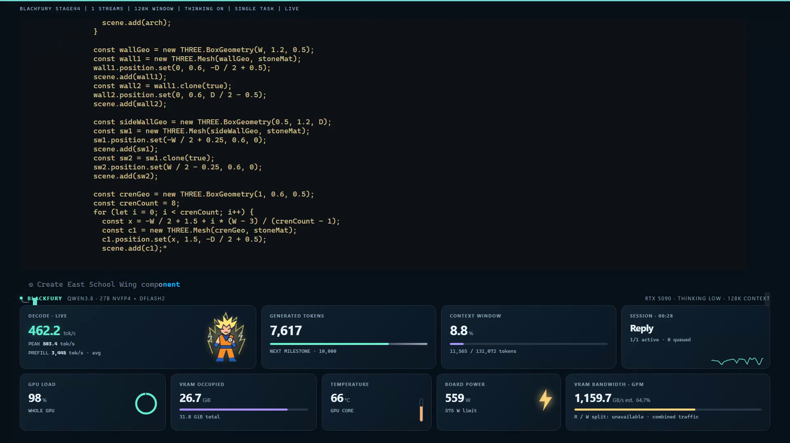
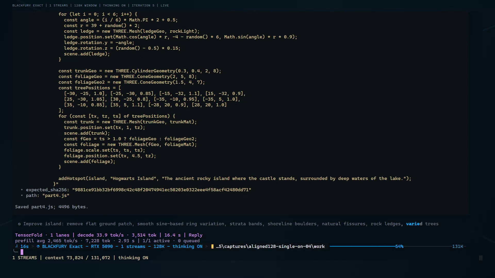
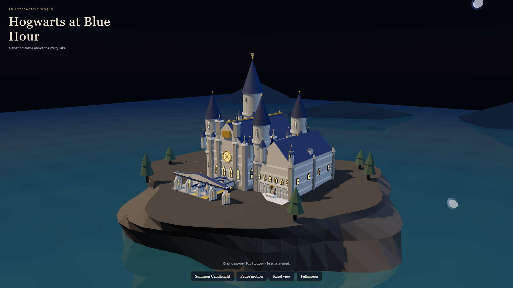
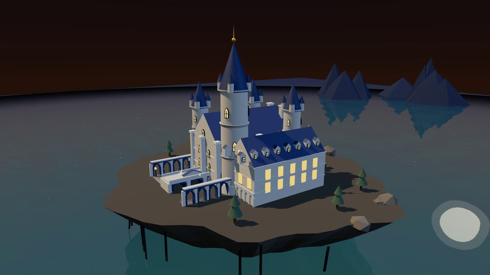
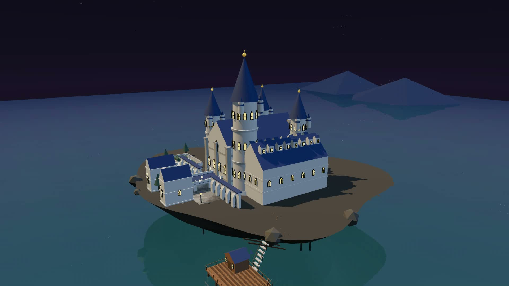

<h1 align="center">BLACKFURY Exact V 1.0.1</h1>

**17 November 2026 update:** Qwen3.8-27B NVFP4 + DFlash2 on one RTX 5090 32 GB, powered by TensorFold. V 1.0.1 adds the paired FP4 gate/up projection kernel (`tf_qmmf_fp4_pair`). All active inference state stays in GPU VRAM.

| Measurement | V 1.0.1 result |
|---|---:|
| Controlled 129,024-input + 2,048-output test, warm decode median | **309.53 tok/s** |
| Gain over the Stage41 control in that test | **+0.891%** |
| Separate coding task, weighted decode across 36 requests | **376.54 tok/s** |
| Approximately one-second sample in that coding task | **753.29 tok/s peak** |

The coding task used shorter actual inputs and different cache conditions; its peak is not sustained full-context throughput. [Full results and methodology](docs/blackfury-stage44.md) · [Build V 1.0.1](variants/blackfury-stage44/README.md) · [Verify 32 recorded requests](results/blackfury-stage44/).

[](https://drive.google.com/file/d/14rijQHUTPrr-30HSkUxw2ipJ6JEmQHhP/view)

[Watch the agent — 6:03](https://drive.google.com/file/d/14rijQHUTPrr-30HSkUxw2ipJ6JEmQHhP/view) · [Watch the resulting scene — 20 seconds](https://drive.google.com/file/d/1Ca1HmDVqGv9h1Tk7Rmc8OtqmxgJlKtbQ/view). 1080p/60 fps, normal speed. Peak near **05:21.5**. The recording shows the technical build name, Stage44.

V 1.0.1 (technical build: Stage44) inherits an approximate FP8 attention path and has an unresolved inherited-prefill race diagnostic; see the [qualification limits](docs/blackfury-stage44.md#source-build-and-limitations). **The previous BLACKFURY Exact version remains available below**, with its own measurements and byte-match evidence. These variants have different numerical and validation guarantees.

## Previous BLACKFURY Exact version

<p align="center"><strong>Single-stream inference optimized for RTX 5090</strong></p>
<p align="center">Qwen3.8-27B NVFP4 + DFlash2 · 131,072-token context · One 32 GB GPU</p>
<p align="center"><strong>280.88 tok/s warm decode median at 129,024 input + 2,048 output tokens</strong><br>Byte-matched against the preserved original in verified tests.</p>

<p align="center">
  <a href="#install"></a>
  <a href="#watch-blackfury-exact"></a>
  <a href="results/blackfury-exact/reproduction/README.md"></a>
  <a href="docs/blackfury-exact.md"></a>
</p>
<p align="center">
  <a href="CREDITS.md"></a>
  <a href="LICENSE"></a>
  <a href="https://github.com/Maharajahu/qwen3.8-27b-nvfp4-blackfury-exact-tensorfold/releases/tag/demos-2026-11"></a>
</p>

<p align="center">
  <a href="https://x.com/ToolBraidComp"></a>
  <a href="https://buymeacoffee.com/dumitrescup"></a>
</p>

<p align="center">Built on <a href="https://github.com/ashhart/TensorFold"><strong>TensorFold</strong></a> by <a href="https://github.com/ashhart">Ash (@ashhart)</a> and its contributors.</p>

**The previous BLACKFURY Exact build is retained here with its original evidence.** It optimizes long-context attention while preserving the original reduction order and rounding in the tested cases. It runs Qwen3.8-27B NVFP4 with a four-bit DFlash2 drafter and FP8 KV cache on one RTX 5090; all active inference state stays in GPU VRAM. The native server exposes an OpenAI-compatible API for your own clients. [Oh My Pi](https://github.com/can1357/oh-my-pi) was used for the filmed coding-agent demonstration.

The repository includes the source patch, pinned checkpoints, build scripts, exact workloads, raw receipts and recordings. Earlier parallel engines remain available under [other variants](#other-engine-variants).

## Single-stream results

### Controlled 131K test

**129,024 input + 2,048 generated tokens = 131,072 tokens.** One stream, thinking LOW, greedy decoding, seed 42. Output tokens include reasoning. Measured on Windows / RTX 5090 32 GB on 15 November 2026.

| Metric | Preserved original | BLACKFURY Exact |
|---|---:|---:|
| Warm-prefix decode, median | 268.57 tok/s | **280.88 tok/s (+4.58%)** |
| Fastest complete warm request | 268.89 tok/s | **281.19 tok/s** |
| Cold prefill, 129,024 tokens | 50.35 s | **50.44 s** |
| Cold prefill rate | 2,562.7 tok/s | **2,558.2 tok/s** |
| Warm-prefix first token, median | 0.237 s | **0.235 s** |

Peak measured device memory for BLACKFURY Exact: **27.42 GiB**, including display and driver allocations. Two fresh processes per engine, each with one cold and two warm requests, in an interleaved comparison. Warm requests reuse 128,896 prompt tokens. Decode rates exclude prefill; process/model loading is separate. These are measured local results, not guaranteed speeds. [Full conditions and per-request results](docs/blackfury-exact.md#controlled-128k-single-stream-test).

**Output matches the original reference byte for byte in the verified tests: token IDs, text and reasoning.** The published packet contains six BLACKFURY Exact requests and six original-reference requests, with their raw SSE responses and JSON receipts. The offline verifier reconstructs each response and compares the actual output. This is measured equivalence for those inputs, not a claim covering every possible prompt.

[Verify the byte-match evidence](results/blackfury-exact/reproduction/README.md) · [Exact prompt, checkpoints and recorded commands](results/blackfury-exact/reproduction/README.md#build-and-launch-the-same-settings) · [Source and binary identities](engine-manifest.json)

### Separate real coding loop

| Single-stream metric | Measured result |
|---|---:|
| Weighted decode average across nontruncated requests | **330.37 tok/s** |
| Highest approximately one-second decode sample | **734.17 tok/s** |
| Complete recorded-loop output / elapsed time | **155.76 tok/s** |

Thinking LOW, one continuous build/check/improve session. Whole-file updates repeat existing source, which affects speculative acceptance. The 734.17 tok/s sample is a short peak; it is separate from the controlled full-context result above. [Timing boundaries and request data](docs/blackfury-exact.md#real-coding-loop-peak-and-average-are-different).

## Watch BLACKFURY Exact

<table>
  <tr>
    <th width="50%">Single-stream live agent</th>
    <th width="50%">Generated scene in daylight</th>
  </tr>
  <tr>
    <td width="50%" valign="top" align="center">
      <a href="https://github.com/Maharajahu/qwen3.8-27b-nvfp4-blackfury-exact-tensorfold/releases/download/demos-2026-11/blackfury-exact-live-low-128k-1080p.mp4"></a>
      <p><strong>8 min 18 s · Thinking LOW · One stream</strong></p>
      <a href="https://github.com/Maharajahu/qwen3.8-27b-nvfp4-blackfury-exact-tensorfold/releases/download/demos-2026-11/blackfury-exact-live-low-128k-1080p.mp4">Watch / download the continuous session</a>
    </td>
    <td width="50%" valign="top" align="center">
      <a href="https://github.com/Maharajahu/qwen3.8-27b-nvfp4-blackfury-exact-tensorfold/releases/download/demos-2026-11/blackfury-exact-scene-daylight-1080p.mp4"></a>
      <p><strong>30 s · Output from the same session</strong></p>
      <a href="https://github.com/Maharajahu/qwen3.8-27b-nvfp4-blackfury-exact-tensorfold/releases/download/demos-2026-11/blackfury-exact-scene-daylight-1080p.mp4">Watch / download the scene walkthrough</a>
    </td>
  </tr>
</table>

The live session completed ten iterations and reached **130,842 / 131,072 occupied tokens**. Its final attempted edit hit the context limit and was not applied; the working scene from iteration ten was preserved. The scene is a stylized demonstration. Original 1080p exports are hosted on GitHub Releases without re-encoding. [Video provenance and SHA-256 checksums](docs/videos.md).

## Requirements

The tested target is **Windows x64 with an NVIDIA RTX 5090, 32 GB VRAM**. Other GPUs and operating systems have not been qualified for these patches. Use one variant at a time so their models do not compete for VRAM.

- Git and Python 3.11 or later (tested with 3.12.10).
- Zig **0.17.0** and CUDA Toolkit **13.3**, including `nvcc`.
- Visual Studio 2022 C++ Build Tools and a Windows SDK. The original build used MSVC 14.44.35207 and Windows SDK 10.0.26100.0.
- A compatible NVIDIA driver and enough disk space for both checkpoints, the selected source/build directory, and build caches. Model downloads are large; the manifest lists exact file sizes.

Node.js 24 with npm and a browser are needed only for the optional agent/scene examples. The native BLACKFURY server does not require OMP.

TensorFold is pinned to `6e9af930261a88bb28ac0bfb157ce8e57e9eea07`. The bundled earlier agent launchers retain OMP **18.18.8**; the new BLACKFURY measurements used **18.20.2**. The BLACKFURY native server runs independently of OMP. Models are pinned to exact revisions of `nvidia/Qwen3.8-27B-NVFP4` and `z-lab/Qwen3.8-27B-DFlash2`. Setup verifies file hashes and downloads no model code for execution.

## Install

Build only BLACKFURY Exact with these PowerShell commands. Compiler/toolkit locations can be supplied with `--zig` and `--cuda-path` if they are not detected automatically.

```powershell
git clone https://github.com/Maharajahu/qwen3.8-27b-nvfp4-blackfury-exact-tensorfold.git
cd qwen3.8-27b-nvfp4-blackfury-exact-tensorfold
python -m venv .venv
& .\.venv\Scripts\python.exe -m pip install -r requirements.txt
& .\.venv\Scripts\python.exe scripts/setup.py models
& .\.venv\Scripts\python.exe scripts/setup.py prepare --variant blackfury-exact
& .\.venv\Scripts\python.exe scripts/setup.py build --variant blackfury-exact
& .\.venv\Scripts\python.exe variants/blackfury-exact/runtime_control.py start
```

For an explicit compiler location, add `--zig 'C:\tools\zig\zig.exe' --cuda-path 'C:\Program Files\NVIDIA GPU Computing Toolkit\CUDA\v13.3'` to the build command. With portable CUDA, set `$env:CUDA_PATH` to its installation directory in the terminal used to start the server, so it can find the runtime DLLs. The build targets SM120 and writes the executable under `.runtime/blackfury-exact/`.

The model command downloads and verifies both pinned checkpoints. To reuse local copies, replace that command with:

```powershell
& .\.venv\Scripts\python.exe scripts/setup.py models --model-path 'C:\models\Qwen3.8-27B-NVFP4' --drafter-path 'C:\models\Qwen3.8-27B-DFlash2'
```

**Server:** `http://127.0.0.1:18210/v1` · **Model ID:** `blackfury-exact` · **Defaults:** one stream, 131,072-token context, thinking LOW, DFlash2 enabled. Connect an OpenAI-compatible client after `start` reports a healthy server.

```powershell
& .\.venv\Scripts\python.exe variants/blackfury-exact/runtime_control.py status
& .\.venv\Scripts\python.exe variants/blackfury-exact/runtime_control.py stop
```

`stop` checks process identity and stops only this launcher's server. The general launcher uses a **1,024-token thinking budget**. To reproduce the controlled benchmark's **2,048-token budget**, use its [recorded command and exact request](results/blackfury-exact/reproduction/README.md). A fresh build's executable hash may differ from the measured binary; source reconstruction and output matching are checked separately.

After cloning, the published output evidence can also be verified **without a GPU or downloaded models**:

```powershell
python scripts/verify_blackfury_receipts.py
```

Expected: **30 archived files and 12 original/exact requests verified**, with identical token IDs, text and reasoning. [Detailed launch options](variants/blackfury-exact/README.md).

## Other engine variants

| Variant | Main use | Measured example | Instructions |
|---|---|---|---|
| `experimental12` | Twelve synchronized branches, shared GPU context, thinking LOW | 791 tok/s across the filmed group; 1,081 tok/s sampled aggregate peak | [Build and run](variants/experimental12/README.md) |
| `shared-context` | Earlier eight-branch shared-context agent, thinking LOW | 498.99 tok/s aggregate | [Agent example](variants/shared-context/demo/README.md) |
| `fanout` | Earlier eight-branch scene agent, thinking OFF | 660.75 tok/s aggregate | [Agent example](#test-the-fanout-version) |

These are separate workloads and timing boundaries, not a ranking against BLACKFURY's single-stream speed. The same BLACKFURY Exact engine also completed a separate twelve-branch thinking-OFF demonstration: **790.23 tok/s across the group**, **1,079.12 tok/s sampled aggregate peak**, with a 65,536-token window and 12,594 maximum actual request input. [Details](docs/blackfury-exact.md#separate-twelve-branch-demonstration).

Use `--variant experimental12`, `--variant shared-context` or `--variant fanout` in setup to build one of the retained variants. Use `--variant all` only when you want all four engines. Install the pinned OMP agent with `python scripts/setup.py omp` for their agent examples.

<details>
<summary>Earlier parallel recordings, measurements and agent examples</summary>

## Retained: experimental twelve-branch engine

**1,081 tokens/s sampled peak · 791 tokens/s across the filmed branch group · 34.2% gain in a separate controlled replay.**

The retained `experimental12` variant runs twelve synchronized LOW-thinking branches with shared GPU prompt state. The filmed run completed twelve distinct scene components: 41,357 completion tokens in 52.27 seconds. A separate three-pair replay measured a median 766.07 tokens/s versus 570.78 for its preserved control, with identical generated token IDs.

The 1,081 tokens/s figure is a short, approximately one-second sampled decode peak. The 791 tokens/s figure is the group average; neither is single-stream speed. [Results, timing boundaries and limitations](docs/experimental12.md).

The update adds compact GPU state, measured multi-lane scheduling costs, faster short prompt-tail processing, file-based proposal delivery and per-task token budgets. The native patch, portable launcher, regression tests and twelve-component workload are included. [Run the experimental engine](variants/experimental12/README.md).

## Watch the recordings

Real agent sessions and the generated scenes. Select a button to download the original 1080p MP4.

<table>
  <tr>
    <th width="50%">01 · Fanout</th>
    <th width="50%">02 · Shared context</th>
  </tr>
  <tr>
    <td width="50%" valign="top" align="center">
      <a href="https://github.com/Maharajahu/qwen3.8-27b-nvfp4-blackfury-exact-tensorfold/releases/download/demos-2026-11/fanout-scene-1080p.mp4"></a>
      <p><strong>660.75 tokens/s aggregate</strong><br>Thinking off · 8 branches<br><sub>11 November 2026</sub></p>
      <a href="https://github.com/Maharajahu/qwen3.8-27b-nvfp4-blackfury-exact-tensorfold/releases/download/demos-2026-11/fanout-live-660tps-1080p.mp4"></a>
      <br>
      <a href="https://github.com/Maharajahu/qwen3.8-27b-nvfp4-blackfury-exact-tensorfold/releases/download/demos-2026-11/fanout-scene-1080p.mp4"></a>
      <br><sub>Live 41s · Scene 20s</sub>
    </td>
    <td width="50%" valign="top" align="center">
      <a href="https://github.com/Maharajahu/qwen3.8-27b-nvfp4-blackfury-exact-tensorfold/releases/download/demos-2026-11/shared-context-scene-low-1080p.mp4"></a>
      <p><strong>498.99 tokens/s aggregate</strong><br>Thinking low · 8 branches<br><sub>12 November 2026</sub></p>
      <a href="https://github.com/Maharajahu/qwen3.8-27b-nvfp4-blackfury-exact-tensorfold/releases/download/demos-2026-11/shared-context-live-low-499tps-1080p.mp4"></a>
      <br>
      <a href="https://github.com/Maharajahu/qwen3.8-27b-nvfp4-blackfury-exact-tensorfold/releases/download/demos-2026-11/shared-context-scene-low-1080p.mp4"></a>
      <br><sub>Live 113s · Scene 25s</sub>
    </td>
  </tr>
</table>

### 03 · Experimental twelve-branch engine

<p align="center">
  <a href="https://github.com/Maharajahu/qwen3.8-27b-nvfp4-blackfury-exact-tensorfold/releases/download/demos-2026-11/experimental12-scene-1080p.mp4"></a>
</p>
<p align="center"><strong>791 tokens/s across the filmed branch group</strong><br>Thinking low · 12 synchronized branches · 12 November 2026</p>
<p align="center">
  <a href="https://github.com/Maharajahu/qwen3.8-27b-nvfp4-blackfury-exact-tensorfold/releases/download/demos-2026-11/experimental12-live-low-791tps-1080p.mp4">Watch the live agent (116 seconds)</a> ·
  <a href="https://github.com/Maharajahu/qwen3.8-27b-nvfp4-blackfury-exact-tensorfold/releases/download/demos-2026-11/experimental12-scene-1080p.mp4">Watch the generated scene (25 seconds)</a>
</p>

The live clip contains the recorded run, including time around the 52.27-second branch generation interval. The scene walkthrough is a separate capture of its output. [Results and timing boundaries](docs/experimental12.md).

Live clips retain the captured timing; scene walkthroughs are separate recordings of the generated outputs. Video duration differs from the measured generation interval. [Video provenance and checksums](docs/videos.md).

## The earlier eight-branch versions

| | `fanout` — 11 November 2026 | `shared-context` — 12 November 2026 |
|---|---|---|
| Workload | Specialized Three.js scene agent | Coding agent with eight synchronized proposal branches |
| Thinking | Off | Low, with a 2,048-token thinking budget |
| Context setting | 4,096 | 65,536 |
| Parallel branches in the recording | 8 | 8 |
| Completed branch tokens | 13,336 | 27,974, including 16,044 reasoning tokens |
| Parallel generation interval | 20.183 s | 56.061 s |
| **Aggregate throughput** | **660.754 tokens/s** | **498.991 tokens/s** |
| Highest sampled one-second rate | 946.845 tokens/s | 716.289 tokens/s |
| Complete agent turn | 33.542 s | 101.389 s |

These are measured examples, not guaranteed speeds. Aggregate throughput combines concurrent branches; it is not the speed of one response. Peaks are short telemetry windows and are not sustained averages. The two workloads, thinking settings, and timing boundaries differ, so this table is not a controlled performance comparison. See [measurement details](docs/measurements.md) and the [recorded data](results/recorded-runs.json).

`fanout` plans and builds a stylized castle scene with eight components. It uses a reduced draft-output projection for a seven-node draft tree. `shared-context` reuses common prompt state in GPU memory and starts a group of branches together. Its coordinator integrates the proposals and runs checks. It can also work on other coding tasks; the published performance result is only for the supplied scene workload.

## Optional scene dependencies

For the retained Three.js agent examples:

```powershell
npm ci --prefix variants/fanout/lint
& .\.venv\Scripts\python.exe variants/fanout/prepare_assets.py
& .\.venv\Scripts\python.exe -m playwright install chromium
```

## Test the experimental twelve-branch version

```powershell
.\variants\experimental12\Start-Agent.cmd -WorkingDirectory 'C:\work\experimental12'
```

Use `--variant experimental12` in setup to build only that engine. The default launcher reserves twelve lanes; admission remains subject to available GPU memory. [Usage and scene workload](variants/experimental12/README.md).

## Test the fanout version

```powershell
.\variants\fanout\Start-Agent.cmd
```

Enter the recorded prompt:

> build me a html three.js website for harry potter, it should be a masterpiece.

The terminal shows the concurrent component streams and measured throughput. The scene is written inside the selected workspace. The historical result is a stylized scene; the wording of the prompt is not a claim of photorealistic or masterpiece quality.

To use another empty workspace:

```powershell
.\variants\fanout\Start-Agent.cmd -WorkingDirectory 'C:\work\fanout-test'
```

## Test the shared-context version

```powershell
.\variants\shared-context\Start-Agent.cmd -WorkingDirectory 'C:\work\shared-agent-test'
```

For your own coding task, ask the agent to implement it, use independent branches where useful, integrate the results, and run tests. Add `-Continue` to resume the latest conversation in that workspace.

The recorded scene example and its launch instructions are in [the shared-context workload](variants/shared-context/demo/README.md). Its prepared inputs define eight components; the model must generate and integrate their implementation. The recorded launcher prompt was:

> Build the scene in TASK.md with eight synchronized branches. Integrate the files and verify the result in the browser. Use English throughout; finish with a two-line summary.

The OMP agent launchers stop a runtime they started when OMP exits; the standalone BLACKFURY server uses the explicit `stop` command in its guide. Each runtime binds to localhost only. The agent's file and terminal tools operate with your user account's permissions; use a disposable project when experimenting. Generated source and conversation receipts are saved locally and excluded from Git.

## Inspect and stop a runtime

```powershell
& .\.venv\Scripts\python.exe variants/fanout/runtime_control.py status
& .\.venv\Scripts\python.exe variants/fanout/runtime_control.py stop
& .\.venv\Scripts\python.exe variants/shared-context/runtime_control.py status
& .\.venv\Scripts\python.exe variants/shared-context/runtime_control.py stop
```

The helpers only stop their own recorded process, after checking its identity. The inference ports are 18190 (`fanout`), 18192 (`shared-context`), 18198 (`experimental12`) and 18210 (`blackfury-exact`). If a port belongs to another service, setup refuses to replace it.


</details>

## Validation and reporting results

Start with the [BLACKFURY Exact measurements](docs/blackfury-exact.md), [reproducible 131K baseline](results/blackfury-exact/reproduction/README.md) and [package validation](docs/validation.md). For comparisons, report the variant, GPU/VRAM, OS, driver, compiler versions, model revisions, context, thinking budget, concurrency, completed tokens and timing boundary. Include failed runs as well as successful ones. [Measurement definitions for all variants](docs/measurements.md).

## Credits and origin

The starting point is **[TensorFold](https://github.com/ashhart/TensorFold), created by [Ash (@ashhart)](https://github.com/ashhart) and its contributors**. Ash's fanout demonstrations inspired the first experiment. This repository builds on the native TensorFold engine and adds the experimental Windows patches, OMP integrations, workloads and reproduction scripts shown here.

| Project / authors | Contribution to these experiments |
|---|---|
| [TensorFold · Ash and contributors](https://github.com/ashhart/TensorFold) | Native inference engine; all four patches start at [commit `6e9af93`](https://github.com/ashhart/TensorFold/commit/6e9af930261a88bb28ac0bfb157ce8e57e9eea07). |
| [Oh My Pi · @can1357, Stencil Labs and contributors](https://github.com/can1357/oh-my-pi) | Coding-agent terminal, conversation and extension runtime; earlier bundled launchers use 18.18.8, while the BLACKFURY coding-loop measurement used 18.20.2. |
| [Qwen team / Alibaba](https://huggingface.co/Qwen/Qwen3.8-27B) · [NVIDIA](https://huggingface.co/nvidia/Qwen3.8-27B-NVFP4) | Qwen3.8-27B base model and the NVFP4 checkpoint used here. |
| [Inco AI](https://inco.ai/blog/dflash2/) · [Z Lab](https://github.com/z-lab/dflash) | DFlash 2 speculative drafter and original DFlash research; the pinned checkpoint is from the [Z Lab mirror](https://huggingface.co/z-lab/Qwen3.8-27B-DFlash2). |
| [Three.js contributors](https://github.com/mrdoob/three.js/tree/r180) | 3D rendering library for the demonstration scenes. |
| [Maharajahu](https://github.com/Maharajahu) | Local experiment patches, agent harnesses, RTX 5090 measurements, recordings and portable setup in this repository. |

[Full credits, pinned sources and research references](CREDITS.md). The local OMP integration is independently implemented; the upstream engine and its authors retain their attribution.

## License

Local code and changes are provided under [Apache-2.0](LICENSE). Upstream copyright and third-party notices are retained in [licenses/TensorFold](licenses/TensorFold). External models, OMP, Three.js, and other dependencies retain their respective licenses. No model weights or prebuilt executables are committed.

## Feedback and support

[Report an issue](https://github.com/Maharajahu/qwen3.8-27b-nvfp4-blackfury-exact-tensorfold/issues/new) with the variant, hardware, setup command and relevant error. For performance reports, include the settings and timing boundary described in [measurement details](docs/measurements.md).

Maintained by [Maharajahu](https://github.com/Maharajahu). Follow [@ToolBraidComp](https://x.com/ToolBraidComp) for updates or [buy me a coffee](https://buymeacoffee.com/dumitrescup) to support the work. Donations are optional; the source and instructions are available to everyone.
