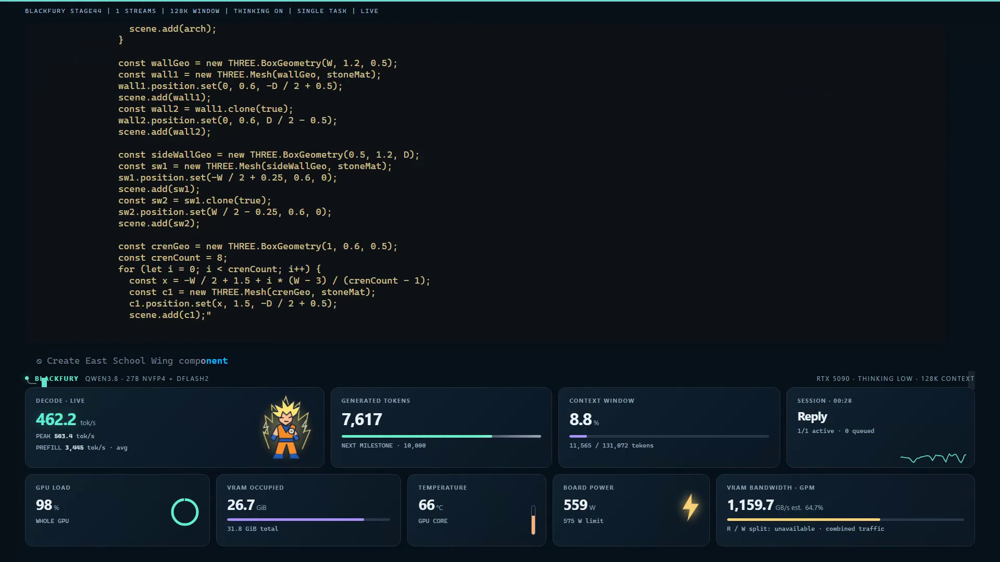

# BLACKFURY Exact V 1.0.1 — 17 November 2026

BLACKFURY Exact V 1.0.1 (technical build: Stage44) adds the opt-in `tf_qmmf_fp4_pair` CUDA kernel to the TensorFold-based single-stream engine. It runs the gate and up projections in one two-dimensional CUDA grid. Separate CTAs reuse the existing FP4 arithmetic body, preserving each projection's summation order. This reduces launch overhead without introducing a new approximation in the paired projection.

This version is packaged separately from the previous **BLACKFURY Exact** build. It inherits Stage41's approximate FP8 attention implementation. It is not a claim of universal numerical equivalence to upstream, nor a new TensorFold upstream release. Stage45 and the subsequent E2M1 prefill candidate are not included.

## Controlled full-context result

Windows, RTX 5090 32 GB, Qwen3.8-27B NVFP4, four-bit DFlash2 drafter, all active inference state in GPU VRAM. Configured context 131,072; actual input 129,024 tokens and output 2,048 tokens. Single stream, greedy, seed 42, thinking LOW with a 2,048-token reasoning budget. A1–B1–B2–A2 ordering, fresh process per cell, one cold and three warm requests, repeated with and without DFlash2: 32 requests total. No profiling, recording or compilation during these timing runs.

| Warm decode median | Stage41 control | Stage44 paired FP4 | Change |
|---|---:|---:|---:|
| DFlash2 | 306.80080 tok/s | **309.53399 tok/s** | **+0.891%** |
| No drafter | 54.60800 tok/s | **55.61017 tok/s** | **+1.835%** |

Six warm samples per arm and mode contribute to each median. Cold prefill with DFlash2 was 50.27404 s for the control and 50.36820 s for Stage44; there is **no measured prefill improvement**. Warm first-token latency remained approximately 0.236 s. These numbers are specific to this workload, hardware and cache state.

All 32 requests produced the same 2,048 token IDs, including between drafted and plain execution. This is measured equivalence to the recorded Stage41 control on this fixture, not proof for arbitrary prompts. The output limit makes this a throughput/equivalence fixture, not an application-completion benchmark.

Run `python scripts/verify_stage44_receipts.py` offline to hash-check the packet, bind receipts to the original SSE stream, compare output IDs and recompute medians. [Receipts and configuration](../results/blackfury-stage44/) include a synthetic request template. Set its model ID to `blackfury-exact-v1.0.1`; use `draft: false` for the plain mode. The recorded configuration distinguishes the benchmark's settings from the launcher's demonstration defaults.

## Paired-projection qualification

- Dispatch: SM120, BF16 outputs, rows 1–16, N=17,408, K=5,120, split-K=1 and compatible activation/weight formats. Other shapes retain the original path.
- Opt-in switch: `TF_QWEN_FP4_PAIR=1`; the supplied Stage44 launcher enables it.
- Kernel resources: 49 registers, zero local-memory bytes, 17,408 shared-memory bytes.
- 35 bitwise correctness cases, input preservation and output guards; targeted memcheck, synccheck and racecheck completed successfully. [Qualification summary](../results/blackfury-stage44/fp4-kernel-qualification.json) and logs are included.
- The same-fatbin microbenchmark measured 68.88213 → 65.78225 microseconds for the projection pair. This microkernel result is not an end-to-end speedup claim.
- Archived native/Qwen builds and affected host tests passed before the controlled run. Publication verification is reported separately below.

Measured executable SHA-256: `0bea5590da5be871bad81628c0616a17d6e1a684bfa5b778b82baf61e2b9604f`.

## Real coding demonstration

A separate fresh OMP 18.20.2 session used thinking LOW with a 1,024-token reasoning budget and a 131,072-token window. It generated a stylized Three.js castle, ran five browser checks and applied four rounds of visual repairs. A separate visual supervisor inspected actual browser screenshots and returned feedback to the same local-agent conversation; the local engine is not claimed to have processed images.

| Metric | Result |
|---|---:|
| Approximately one-second sampled peak | **753.29199 tok/s** |
| Weighted decode rate over 36 requests | **376.53669 tok/s** |
| Whole task, including tools and review pauses | **100.08259 output tok/s** |
| Total generated tokens, including reasoning | 35,755 |
| Reasoning tokens | 7,933 |
| Largest actual input | 58,589 tokens |

Decode average = 35,719 decode tokens / 94.8619384 seconds. The first token of each request is produced by prefill, so it is excluded from both the decode counter and this rate. Whole-task average = 35,755 / 357.2549583 seconds. Whole-file repairs repeat existing code and affect speculative acceptance. This shorter-context coding workload is not comparable to the fixed full-context benchmark above. Peak is visible near **05:21.5** in the recording.

[Agent and animated telemetry, 6:03](https://drive.google.com/file/d/14rijQHUTPrr-30HSkUxw2ipJ6JEmQHhP/view) · [Final scene, 20 seconds](https://drive.google.com/file/d/1Ca1HmDVqGv9h1Tk7Rmc8OtqmxgJlKtbQ/view). Both are 1080p/60 fps, normal speed; video decoding and sampled frames were checked. Drive access follows the owner's sharing settings.

GPU bandwidth in this demonstration uses measured NVML GPM combined DRAM utilization. Displayed GB/s is a **derived estimate**, using the reported maximum memory clock and bus width; it is not a direct byte counter. Separate DRAM read/write percentages are unavailable. Ordinary memory-busy percentage is not converted into GB/s. The animation follows measured telemetry; it does not measure performance itself.

## Source, build and limitations

The complete independent patch applies to the pinned TensorFold 1.2.6 commit in [engine-manifest.json](../engine-manifest.json). It includes the inherited changes needed to reconstruct Stage44, not just the small paired-projection delta. Existing variants and their patches remain unchanged. [Build and launch instructions](../variants/blackfury-stage44/README.md).

The attention path contains frozen generated SM120 cubins and adapter fatbins. Their hashes are covered by the manifest. The corresponding modified attention generator and local MMA helper are retained under `variants/blackfury-stage44/attention-source/`; the generator preserves its NVIDIA copyright/license headers. Regeneration requires the matching cuDNN/CuTe development environment; the standard build consumes these pinned attention artifacts and compiles ordinary CUDA source. A fresh executable is not promised to match the measured binary byte for byte.

**Known unresolved inherited-prefill diagnostic:** a later large frozen-baseline prefill racecheck reported shared-memory RAW/WAR hazards. The investigation did not establish whether this is a kernel defect or a tooling/interpretation issue. Small baseline-only ordinary and synccheck probes subsequently passed, but do not clear the race report. This concerns the inherited prefill kernel, not a successful full-engine racecheck of Stage44. No later prefill candidate was promoted. Do not interpret the paired-kernel checks or output fixture as comprehensive safety qualification.

Publication checks passed: clean patch reconstruction, 188 source hashes, a complete native build targeting SM120a, 219 CPU host tests, five setup tests, launcher configuration checks and offline verification of 32 archived requests. The per-variant target is required by the inherited packed FP8-to-BF16 conversion. The new executable was not run on the GPU; performance numbers above come from the recorded binary, not this rebuild. [Publication receipt](../results/blackfury-stage44/publication-checks.json) records both binary hashes.
